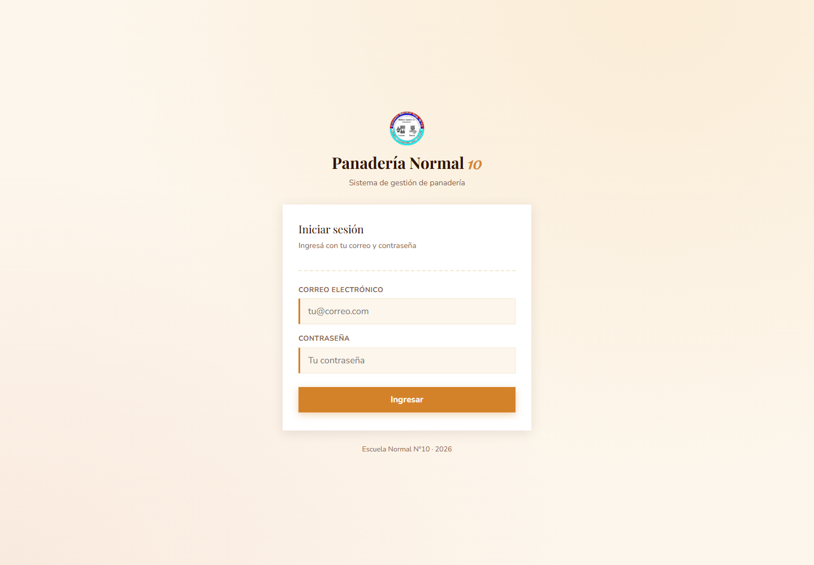
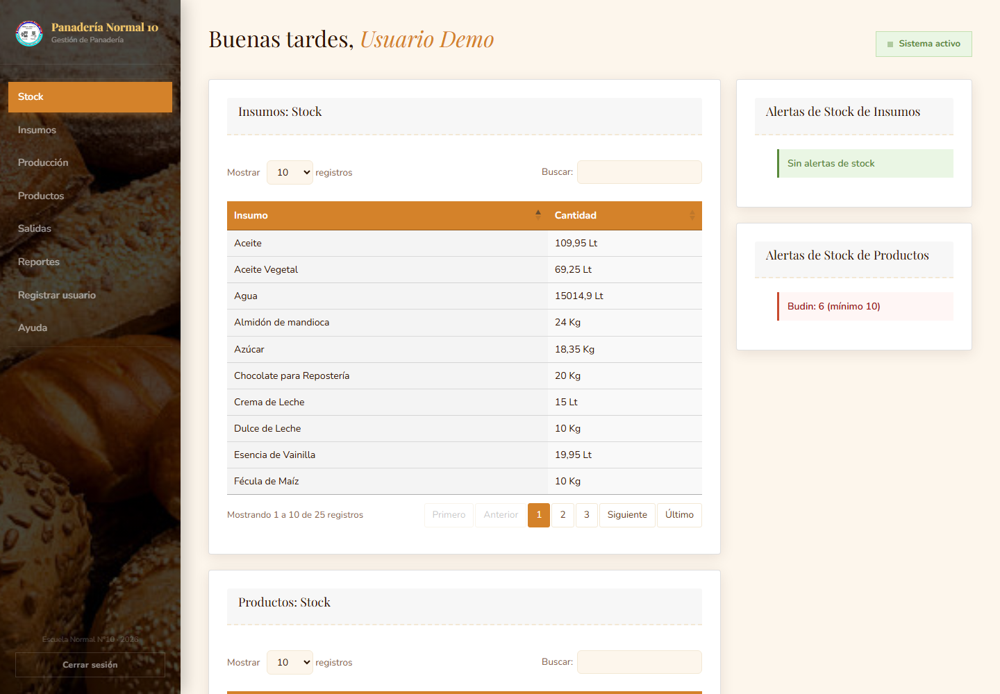
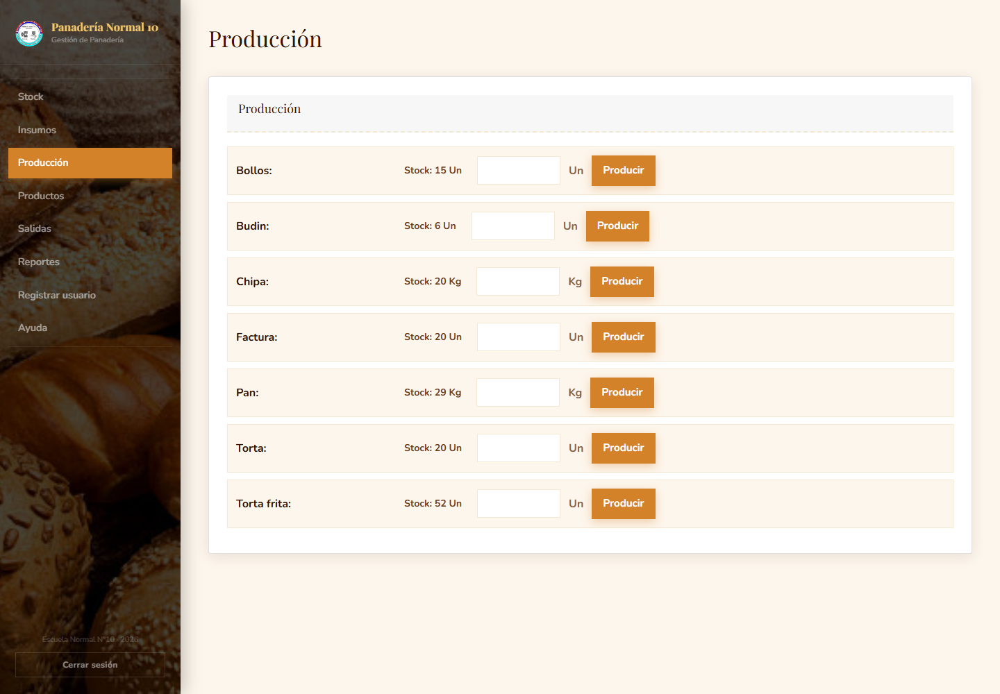
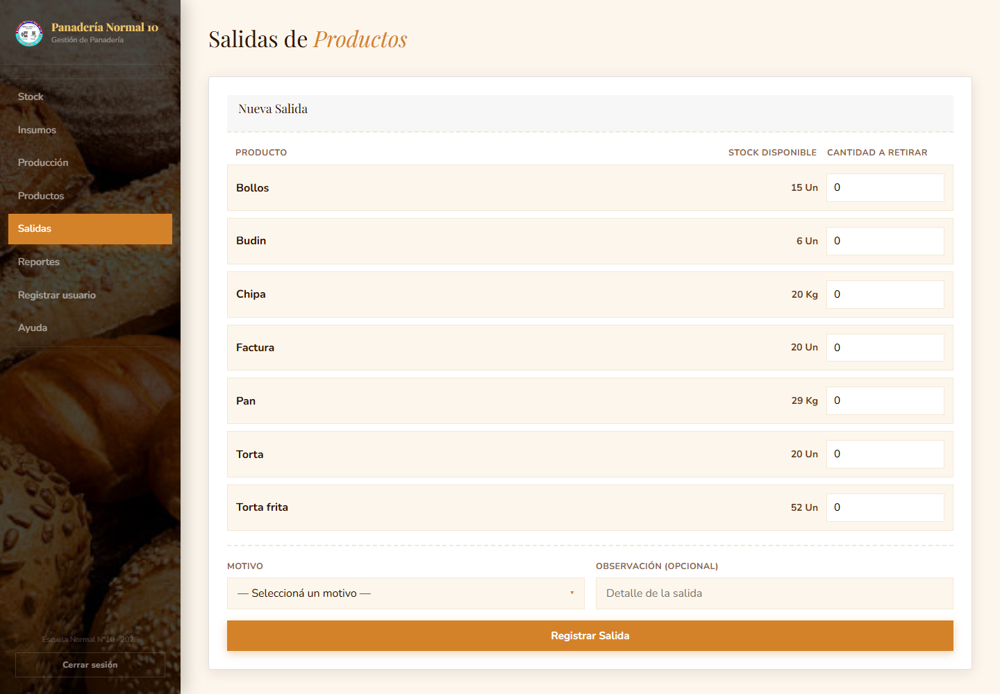
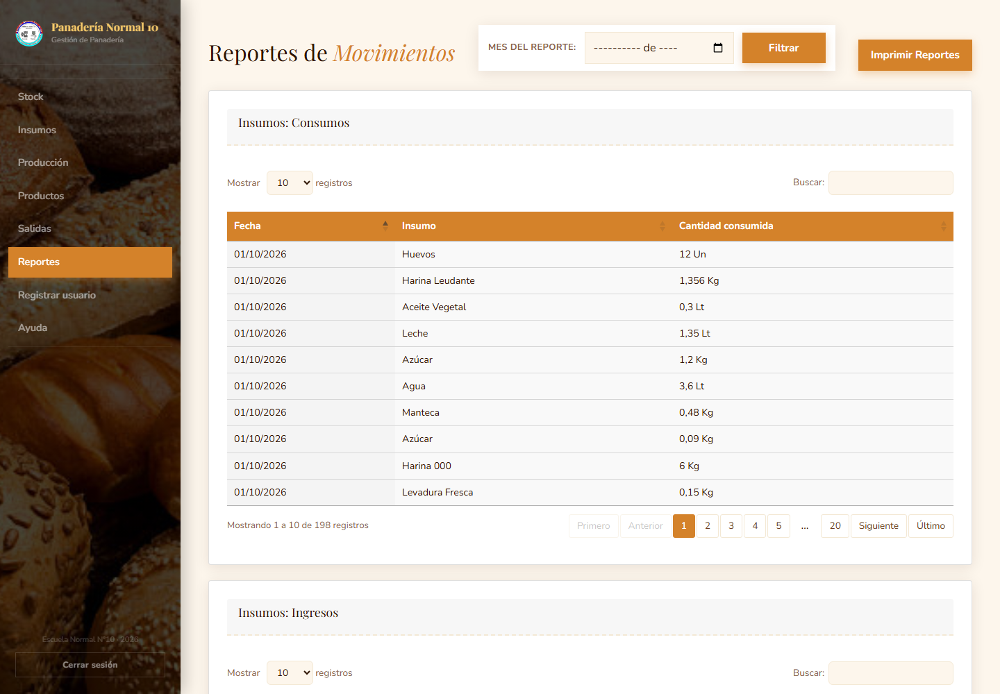

# 🥖 Panadería Normal 10 — Sistema de Gestión

Sistema web para administrar una panadería: control de insumos, recetas, producción, stock de productos, salidas y reportes. Desarrollado como proyecto de la **Escuela Normal N°10** (2026).



---

## ✨ Funcionalidades

- **Inicio de sesión con roles:** Administrador y Panadero.
- **Panel principal:** resumen de stock y alertas de mínimos.
- **Insumos:** alta de materias primas y registro de entradas (compras).
- **Productos:** alta de productos y definición de recetas.
- **Producción:** registra la elaboración, descuenta insumos y suma stock de producto.
- **Salidas:** ventas mostrador, consumo interno, merma, rotura, donación u otro motivo.
- **Reportes:** historial de producción, compras y salidas, filtrable por mes y exportable a PDF.
- **Usuarios:** el Administrador puede dar de alta nuevos usuarios.
- **Ayuda:** preguntas frecuentes y formulario de contacto que envía un correo al administrador.

---

## 🧰 Tecnologías

| Capa | Herramientas |
|---|---|
| Backend | PHP 8.2 (procedural + POO puntual) |
| Base de datos | MySQL / MariaDB 10.4 |
| Frontend | HTML5, CSS3, JavaScript, Bootstrap 5.3.3 |
| Tablas | DataTables |
| Correo | PHPMailer |
| PDF | Dompdf |
| Servidor local | XAMPP (Apache + MySQL/MariaDB) |

---

## 📋 Requisitos

- **XAMPP** con Apache y MySQL/MariaDB iniciados.
- **PHP 8.2 o superior** con las extensiones:
  - `mysqli`
  - `mbstring`
  - `openssl`
  - `zip`
- Navegador moderno (Chrome, Edge, Firefox).

> En XAMPP las extensiones anteriores vienen habilitadas por defecto.

---

## 🚀 Instalación en XAMPP

### 1. Copiar el proyecto

Copiá la carpeta del proyecto dentro de `htdocs`:

```text
C:\xampp\htdocs\Panaderia
```

> Si ya lo tenés en otra ruta, asegurate de que esté dentro de `C:\xampp\htdocs`.

### 2. Iniciar los servicios

Abrí el **Panel de Control de XAMPP** y iniciá:

- **Apache**
- **MySQL**

### 3. Crear e importar la base de datos

**Opción A — phpMyAdmin (recomendada):**

1. Entrá a <http://localhost/phpmyadmin>.
2. Creá una base de datos llamada `panaderia` con cotejamiento `utf8mb4_general_ci`.
3. Seleccioná la base `panaderia` → pestaña **Importar**.
4. Elegí el archivo `database/panaderia.sql` y confirmá la importación.

**Opción B — línea de comandos (Windows):**

```bat
C:\xampp\mysql\bin\mysql.exe -u root -e "CREATE DATABASE IF NOT EXISTS panaderia CHARACTER SET utf8mb4 COLLATE utf8mb4_general_ci;"
cmd /c "C:\xampp\mysql\bin\mysql.exe -u root panaderia < database\panaderia.sql"
```

### 4. Configurar la conexión

Revisá `conexion.php`. Por defecto usa:

```php
$servidor   = "localhost";
$usuario    = "root";
$contrasena = "";
$base_datos = "panaderia";
```

Si tu MySQL tiene contraseña, cambiala en ese archivo.

### 5. Abrir el sistema

Según el nombre de la carpeta:

```text
http://localhost/Panaderia/
```

> Si la carpeta tiene espacios (por ejemplo `Panaderia Expo/Panaderia`), usá la URL codificada:
> `http://localhost/Panaderia%20Expo/Panaderia/`

---

## 👤 Usuario de prueba

El dump incluye un usuario listo para entrar:

| Rol | Correo | Contraseña |
|---|---|---|
| Administrador | `demo@panaderia.local` | `Demo1234!` |

> También existen usuarios reales cargados en el dump. Sus contraseñas están guardadas con `password_hash()` (bcrypt), por lo que no se pueden leer desde la base.

### Cambiar o recuperar una contraseña

Si necesitás resetear una clave, generá un hash nuevo:

```bat
C:\xampp\php\php.exe -r "echo password_hash('NuevaClave123', PASSWORD_DEFAULT), PHP_EOL;"
```

Y actualizá el usuario en phpMyAdmin o por SQL:

```sql
UPDATE usuarios
SET contrasena = '$2y$10$...hash_generado...'
WHERE correo = 'demo@panaderia.local';
```

---

## 📸 Capturas

| Login | Panel de stock |
|---|---|
|  |  |

| Producción | Salidas |
|---|---|
|  |  |

| Reportes |
|---|
|  |

---

## 🗂️ Estructura del proyecto

```text
Panaderia/
├── index.php                 # Login
├── auth.php                  # Control de sesión y permisos por rol
├── conexion.php              # Conexión a MySQL
├── sidebar.php               # Menú lateral según rol
├── stock.php                 # Panel principal
├── insumos.php               # Entradas de insumos y alta de materias primas
├── productos.php             # Listado de productos
├── nuevo_producto.php        # Alta de producto
├── nueva_receta.php          # Asignación de insumos a un producto
├── produccion.php            # Registro de producción
├── salidas.php               # Registro de salidas
├── reportes.php              # Historial y exportación a PDF
├── registro.php              # Alta de usuarios (solo Administrador)
├── ayuda.php                 # Preguntas frecuentes y contacto
├── logout.php
│
├── PHP/
│   ├── registrar_compra.php
│   ├── registrar_produccion.php
│   ├── registrar_salida.php
│   ├── registrar_insumo.php
│   ├── registrar_producto.php
│   ├── registrar_receta.php
│   ├── envio_registro.php
│   ├── formulario_ayuda.php
│   ├── alerta_stock.php
│   ├── utilidades.php
│   ├── config_panaderia.php  # Configuración SMTP
│   └── PDF/reportes_pdf.php
│
├── CSS/
│   ├── styles.css
│   └── Imagenes/
├── JS/
│   ├── AJAX.js
│   └── datatables_config.js
├── Framework/bootstrap-5.1.3/
├── Libreria/                 # PHPMailer, DataTables, Dompdf
│
├── database/
│   └── panaderia.sql         # Script de creación + datos de ejemplo
│
├── docs/
│   ├── DER.mwb               # Modelo entidad-relación (MySQL Workbench)
│   ├── DER.pdf               # Diagrama exportado
│   └── capturas/             # Capturas para este README
│
└── descartado/               # Código y respaldos antiguos (no forma parte del sistema)
```

> `descartado/` se conserva como archivo histórico. No es necesario para ejecutar el sistema y no se incluye en el flujo de la aplicación.

---

## 🗄️ Base de datos

- Script completo: [`database/panaderia.sql`](database/panaderia.sql)
- Modelo entidad-relación: [`docs/DER.mwb`](docs/DER.mwb)
- Diagrama exportado: [`docs/DER.pdf`](docs/DER.pdf)

El modelo tiene **13 tablas**:

`asunto`, `contacto`, `entrada_insumos`, `insumos`, `produccion`, `productos`, `receta`, `roles`, `salidas_productos`, `stock_insumos`, `stock_productos`, `unidad_de_medida`, `usuarios`.

---

## 🔄 Flujo de uso

1. Cargar las **unidades de medida** y los **insumos**.
2. Registrar **entradas de insumos** (compras).
3. Crear **productos** y asignarles una **receta**.
4. Registrar **producción**: el sistema descuenta insumos y suma stock del producto.
5. Registrar **salidas** por venta, merma, consumo interno, etc.
6. Consultar **reportes** y exportarlos a PDF.

---

## ✉️ Configuración de correo (opcional)

El formulario de ayuda envía un correo al administrador usando Gmail + PHPMailer. La configuración está en:

```text
PHP/config_panaderia.php
```

Para usarlo necesitás una **contraseña de aplicación de Gmail** (no la contraseña normal de la cuenta).

> ⚠️ **Importante:** no subas credenciales reales al repositorio. Si el proyecto es público, rotá la contraseña de aplicación y mantené la configuración fuera de Git. El archivo `.gitignore` ya contempla `PHP/config_panaderia.local.php` para cuando se mueva la configuración sensible a un archivo local.

Si no configurás el correo, el resto del sistema funciona normalmente; solo se omite el envío de la notificación.

---

## 🧭 Roles y permisos

| Módulo | Administrador | Panadero |
|---|---|---|
| Stock | ✅ | ✅ |
| Insumos | ✅ | ✅ |
| Producción | ✅ | ✅ |
| Productos / Recetas | ✅ | ✅ |
| Salidas | ✅ | ✅ |
| Reportes | ✅ | ❌ |
| Registrar usuarios | ✅ | ❌ |
| Ayuda | ✅ | ✅ |

---

## 🛠️ Mejoras futuras

Estas mejoras no afectan el funcionamiento actual, pero dejarían el proyecto más robusto:

- Validar sesión y rol en **todos** los endpoints (`PHP/registrar_*.php`).
- Validar cantidades numéricas y mayores a cero en el servidor (especialmente en Producción).
- Migrar todas las consultas a **sentencias preparadas**.
- Agregar **CSRF** a todos los formularios.
- Reemplazar los `mysqli_error()` expuestos por mensajes genéricos + `error_log()`.
- Separar la configuración sensible (SMTP) en un archivo local fuera de Git.

---

## 👨‍🍳 Autor

**Máximo Pedrozo** — Escuela Normal N°10 · 2026

Proyecto desarrollado para la materia de Sistemas / Base de Datos.
